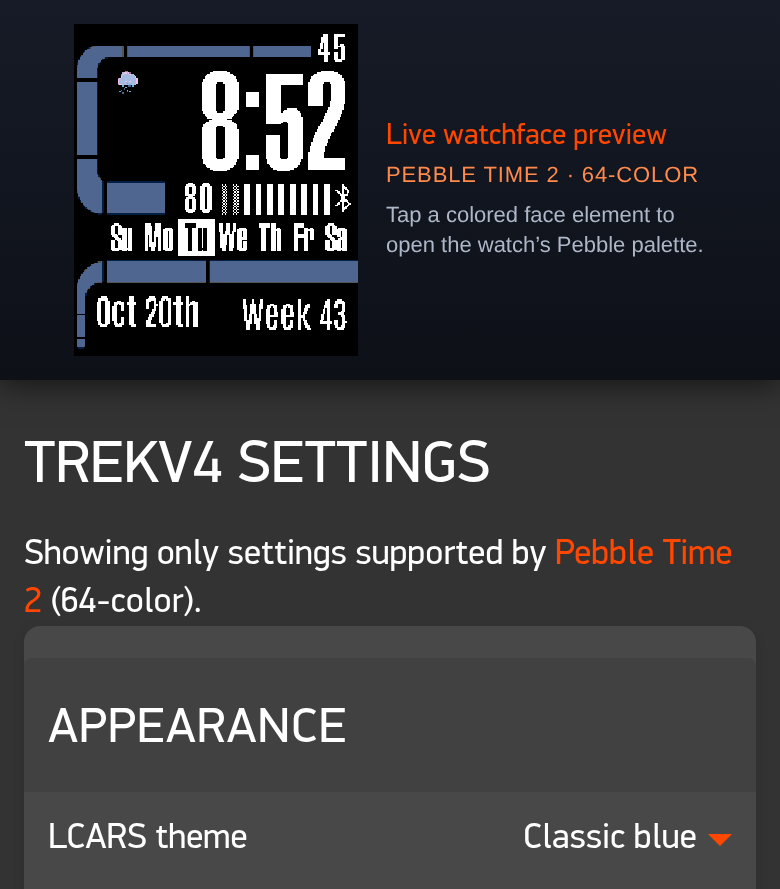

# Trekv4

**An LCARS watchface for Pebble, drawn live in code.**

[**Download**](https://github.com/nbetcher/pebbleface-trekv4/releases/latest) &nbsp;·&nbsp;
[What's new](.github/release-notes/v6.0.0.md) &nbsp;·&nbsp;
[Buy me a coffee](https://buymeacoffee.com/nbetcher)

## Highlights

- **Drawn, not pictured.** The frame is vector geometry rendered on the watch with
  anti-aliased edges. There are no theme images at all.
- **Any piece, any color.** Pick one of 12 classic themes, or recolor each of the
  13 frame pieces, the text, the background, the Bluetooth symbol and the battery bars.
- **A preview you can trust.** The Settings page keeps a live preview pinned on
  screen. On Pebble Time 2 it runs the watchface's own drawing code, translated to
  JavaScript, so it matches the watch pixel for pixel. Tap anything to recolor it.
- **Every rectangular Pebble.** One design, tuned to each screen, from the
  original Pebble to Pebble Time 2.
- **Red Alert.** Nine Star Trek-themed disconnect vibrations, optional repeats
  and an LCARS popup you shake away.
- **Weather with no account.** Powered by Open-Meteo. Location stays off until
  you turn it on.
- Steps, heart rate, a Quiet Time indicator, and 17 languages.

<table>
  <tr>
    <td align="center" width="50%"> Settings, with the pinned live preview</td>
    <td align="center" width="50%"> The disconnect alert</td>
  </tr>
</table>

## Install

1. Download `trekv4-v6.0.0.pbw` from the
   [latest release](https://github.com/nbetcher/pebbleface-trekv4/releases/latest).
2. Open it on your phone with your Pebble app.
3. Open the watchface's settings in the app to make it yours.

Your settings carry over from earlier versions automatically.

## Supported watches

Pebble and Pebble Steel · Pebble Time and Time Steel · Pebble 2 SE and HR ·
Pebble 2 Duo · Pebble Time 2

Round watches are not supported. Pebble Time Round owners should stay on 5.2.

## Credits

Trekv4 grew out of [Trekv3](https://github.com/nbetcher/pebbleface-trekv4/tree/bc1d342)
by **Mark Reed** (2017), which gave it its LCARS layout, theme palette and
languages. Version 6.0 is a ground-up rebuild. About 96% of today's source is new.

|          | Trekv3 (2017)                  | Trekv4 6.0                                         |
| -------- | ------------------------------ | -------------------------------------------------- |
| Frame    | A full-screen picture per theme | Vector shapes drawn live on the watch             |
| Color    | 12 fixed themes                | 12 themes, or any color for every piece            |
| Settings | A plain form                   | Pinned live preview with tap-to-recolor            |
| Watches  | 4 platforms, including Round   | Every rectangular Pebble, including Time 2 and 2 Duo |
| Weather  | Yahoo (since shut down)        | Open-Meteo, no key needed                          |
| Alerts   | A single vibration             | 9 themed patterns, repeats and an LCARS popup      |
| Testing  | None                           | 129 automated tests                                |

## Support

Trekv4 is free. If it brightens your wrist, you can
[buy me a coffee](https://buymeacoffee.com/nbetcher). ☕

## License

Source code is [MIT](LICENSE). Third-party code, fonts and data are listed in
[THIRD_PARTY_NOTICES.md](THIRD_PARTY_NOTICES.md). Weather data is from
[Open-Meteo](https://open-meteo.com/) under CC BY 4.0.

Trekv4 is an unofficial fan project, not affiliated with or endorsed by CBS
Studios or Paramount. Star Trek is a trademark of CBS Studios Inc.

Building from source? See [docs/DEVELOPMENT.md](docs/DEVELOPMENT.md).

Screenshots are rendered by the Settings page's Pebble Time 2 preview engine.
