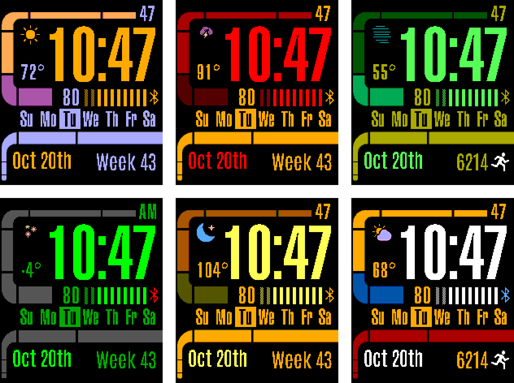
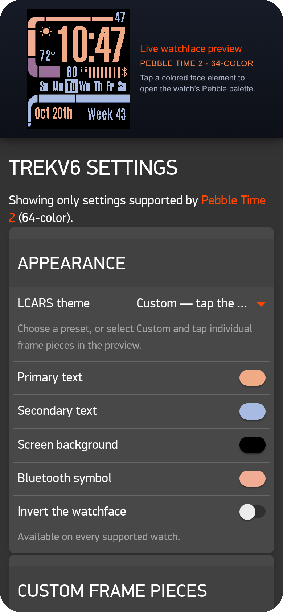
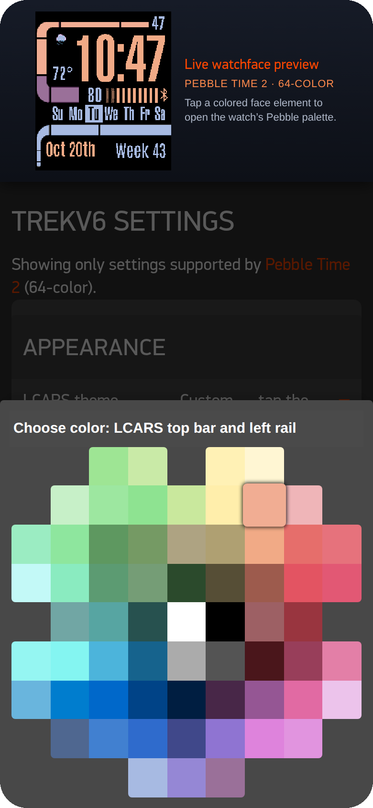
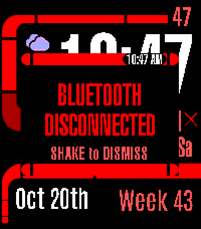

# Trekv6

**An LCARS watchface for Pebble, drawn live in code.**

[**Download**](https://github.com/nbetcher/pebbleface-trekv4/releases/latest) &nbsp;·&nbsp;
[What's new](.github/release-notes/v6.0.0.md) &nbsp;·&nbsp;
[Buy me a coffee](https://buymeacoffee.com/nbetcher)

## See it before you save it

Trekv6's Settings page keeps a **live preview of your watchface** pinned at the top.
Every change you make redraws it instantly: theme, colors, layout, language, even a
24-hour clock or a disconnect alert. **Tap any part of the face to recolor it.**
Nothing reaches the watch until you save.

On Pebble Time 2 the preview isn't a mock-up. It runs the watchface's own drawing
code and Pebble's graphics and text engine, translated to JavaScript, so it matches
the watch **pixel for pixel**. Other watches get a close vector preview.

<table>
  <tr>
    <td align="center" width="50%"> Every change redraws the preview instantly</td>
    <td align="center" width="50%"> Tap the face to pick a new color</td>
  </tr>
</table>

## Highlights

- **Drawn, not pictured.** The frame is vector geometry rendered on the watch with
  anti-aliased edges. There are no theme images at all.
- **Make it yours.** Pick one of 12 classic themes, or build your own palette from
  the frame's three regions, two text colors, the background, the Bluetooth symbol
  and the battery bars.
- **Four watch families.** One design, tuned to each screen: Pebble Time,
  Pebble 2, Pebble 2 Duo and Pebble Time 2.
- **Red Alert.** Nine Star Trek-themed disconnect vibrations, optional repeats
  and an LCARS popup you shake away.
- **Weather with no account.** Powered by Open-Meteo. Location stays off until
  you turn it on.
- Steps, heart rate, a Quiet Time indicator, and 17 languages.

## Palettes to try

Every face above is a custom palette inspired by a corner of the Star Trek universe.
Choose **Custom** in Settings and tap your way to:

| Palette             | Frame: top · middle · bottom                  | Text · secondary      | Inspired by                       |
| ------------------- | --------------------------------------------- | --------------------- | --------------------------------- |
| **LCARS**           | Peach · lilac · periwinkle                    | Orange · periwinkle   | The Next Generation's consoles    |
| **Klingon**         | Blood red · oxblood · gold                    | Red · gold            | Bird-of-Prey displays             |
| **Romulan**         | Deep green · jade · imperial gold             | Bright green · gold   | Warbird green, imperial gold        |
| **Borg**            | Charcoal, all three                           | Borg green · green    | Cube interiors and the red eyepiece laser |
| **Cardassian**      | Bronze · olive · amber                        | Yellow · amber        | Terok Nor's screens               |
| **Original Series** | Command gold · sciences blue · operations red | White · gold          | The 1960s uniforms                |

 Losing your phone puts the bridge on Red Alert

## Install

1. Download `trekv6-v6.0.0.pbw` from the
   [latest release](https://github.com/nbetcher/pebbleface-trekv4/releases/latest).
2. Open it on your phone with your Pebble app.
3. Open the watchface's settings in the app to make it yours.

Upgrading from Trekv4? It installs over it, and your settings carry over.

## Supported watches

Pebble Time and Time Steel · Pebble 2 SE and HR · Pebble 2 Duo · Pebble Time 2

The original Pebble and Pebble Steel are no longer supported: their memory is too
small for Trekv6. Round watches are not supported either. Owners of those watches
can keep the version they already have.

## Credits

Trekv6 grew out of [Trekv3](https://github.com/nbetcher/pebbleface-trekv4/tree/bc1d342)
by **Mark Reed** (2017), which gave it its LCARS layout, classic themes and
languages. Trekv6 is a ground-up rebuild. About 96% of today's source is new.

|          | Trekv3 (2017)                   | Trekv6                                             |
| -------- | ------------------------------- | -------------------------------------------------- |
| Frame    | A full-screen picture per theme | Vector shapes drawn live on the watch              |
| Color    | 12 fixed themes                 | 12 themes, or your own palette                     |
| Settings | A plain form                    | Live, pixel-exact preview with tap-to-recolor      |
| Watches  | 4 platforms, including Round    | 4 platforms, including Time 2 and 2 Duo           |
| Weather  | Yahoo (since shut down)         | Open-Meteo, no key needed                          |
| Alerts   | A single vibration              | 9 themed patterns, repeats and an LCARS popup      |
| Testing  | None                            | 141 automated tests                                |

## Support

Trekv6 is free. If it brightens your wrist, you can
[buy me a coffee](https://buymeacoffee.com/nbetcher). ☕

## License

Source code is [MIT](LICENSE). Third-party code, fonts and data are listed in
[THIRD_PARTY_NOTICES.md](THIRD_PARTY_NOTICES.md). Weather data is from
[Open-Meteo](https://open-meteo.com/) under CC BY 4.0.

Trekv6 is an unofficial fan project, not affiliated with or endorsed by CBS
Studios or Paramount. Star Trek is a trademark of CBS Studios Inc.

Building from source? See [docs/DEVELOPMENT.md](docs/DEVELOPMENT.md).

Watchface screenshots are rendered by the Settings page's Pebble Time 2 preview engine.
